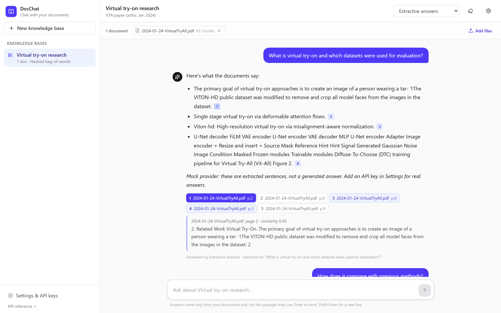
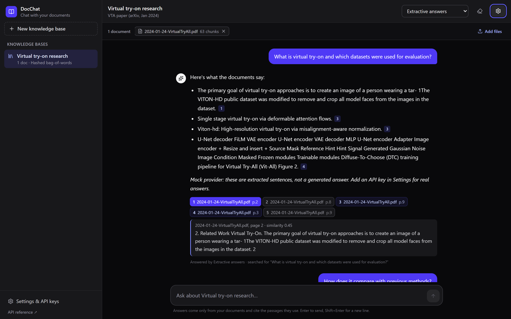
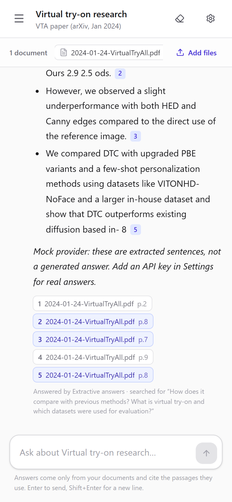
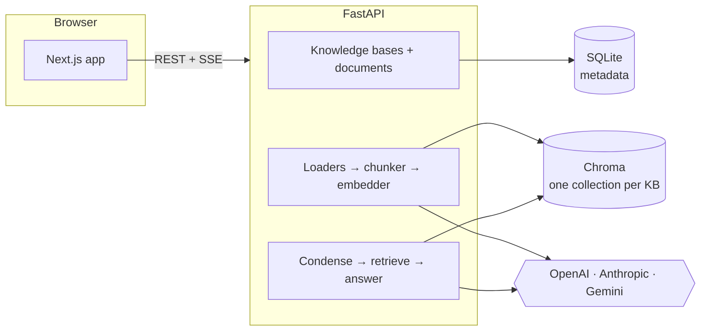

# DocChat: chat with your documents

[](https://github.com/webguru11124/rag-document-chat/actions/workflows/ci.yml)

A retrieval-augmented generation (RAG) app: upload PDFs, Word files, spreadsheets and notes into
knowledge bases, then ask questions. Answers stream in token by token, come only from your files, and
cite the passages they use, which you can open inline.

**Stack:** FastAPI · Python 3.11+ · Chroma · OpenAI / Anthropic / Gemini SDKs · Next.js 16 · React 19 ·
TypeScript · Tailwind CSS 4 · Docker · GitHub Actions



<sub>Screenshots use the built-in offline provider, which quotes matching sentences instead of
generating text. With an API key, the chosen model writes the answer.</sub>

## Features

- **Knowledge bases.** Separate document collections, each tied to one embedding model so vectors
  never mix dimensions.
- **Ingestion.** PDF (page numbers kept, line wrapping and hyphenation undone), DOCX (paragraphs
  and tables), CSV (each row as `column: value` pairs), TXT and Markdown. Recursive chunking,
  SHA-256 duplicate detection, size limits, clear errors for scanned or encrypted PDFs.
- **Retrieval.** Cosine similarity or maximal marginal relevance (MMR), so the passages sent to the
  model don't repeat each other. A retrieval-only `/search` endpoint helps with tuning.
- **Conversations.** Follow-ups like "how does it compare?" are rewritten into a standalone search
  query before retrieval, and the UI shows the query that was used.
- **Grounded answers with citations.** Passages are numbered in the prompt; `[n]` markers in the
  answer become clickable badges that open the source passage with its file, page and similarity score.
- **Several providers.** OpenAI (Responses API), Anthropic Claude and Google Gemini through their
  official SDKs, each with model-specific request rules (see below). Any model ID can be entered as a
  custom model.
- **Bring your own key.** Keys can live on the server, or be pasted in the UI. Pasted keys stay in
  the browser and travel per request in headers; the server never stores them.
- **Offline mode.** A keyless mock provider (hashed bag-of-words embeddings and extractive answers)
  for demos, local development and tests.
- **UI.** Streaming with a stop button, drag-and-drop upload, per-knowledge-base chat history kept
  in local storage, dark mode, phone layout.

<p>
  
  
</p>

## Architecture



**Ask flow** (`POST /api/chat`, streamed as server-sent events):

1. With earlier turns, the model rewrites the latest message as a standalone query.
2. The query is embedded with the knowledge base's embedding model and matched in Chroma
   (similarity or MMR).
3. A `sources` event sends the numbered passages first, so the UI can show them while the answer
   streams.
4. The model answers from those passages only, citing them as `[n]`. Text arrives in `token` events,
   followed by `done`, or by `error` with a readable message.

### Per-model request rules

| Models | What the adapter sends |
| --- | --- |
| GPT-5 family (`gpt-5.4-mini`, `gpt-5-mini`, …) | Responses API with `reasoning.effort: low`; no temperature |
| `gpt-4o-mini` and other non-reasoning OpenAI models | Responses API with temperature |
| Claude Opus 5.5 / Sonnet 5.5 | `output_config.effort: low`, no sampling parameters, server-side refusal fallbacks (`fallbacks: "default"`) |
| Claude Haiku 4.5 | Plain Messages API |
| Gemini 2.5 Flash / Pro | `generate_content_stream` with temperature and system instruction |

These rules live in [`backend/app/providers/catalog.py`](backend/app/providers/catalog.py) and are
covered by unit tests.

## Quick start

### Docker

```bash
cp backend/.env.example backend/.env   # add keys, or keep ENABLE_MOCK_PROVIDER=true
docker compose up --build
```

Open http://localhost:3000. The API and its interactive docs are at http://localhost:8000/docs.

### Local development

Backend (Python 3.11+):

```bash
cd backend
python -m venv .venv
source .venv/bin/activate            # Windows: .venv\Scripts\activate
pip install -r requirements-dev.txt
cp .env.example .env
uvicorn app.main:app --reload --port 8000
```

Frontend (Node 20.9+):

```bash
cd frontend
cp .env.example .env.local
npm install
npm run dev
```

## Configuration

Backend settings come from environment variables or `backend/.env`:

| Variable | Default | Purpose |
| --- | --- | --- |
| `OPENAI_API_KEY`, `ANTHROPIC_API_KEY`, `GOOGLE_API_KEY` | none | Server-side provider keys (all optional) |
| `ENABLE_MOCK_PROVIDER` | `false` | Offer the keyless offline provider |
| `DATA_DIR` | `data` | Where SQLite and Chroma files are written |
| `CORS_ORIGINS` | `http://localhost:3000` | Comma-separated browser origins |
| `MAX_UPLOAD_MB` | `20` | Per-file upload limit |
| `CHUNK_SIZE` / `CHUNK_OVERLAP` | `1000` / `150` | Chunking, in characters |
| `DEFAULT_TOP_K` / `MAX_TOP_K` | `5` / `12` | Passages retrieved per question |

Frontend: `NEXT_PUBLIC_API_URL` (default `http://localhost:8000`).

## API

| Method | Path | |
| --- | --- | --- |
| `GET` | `/api/health` | Liveness |
| `GET` | `/api/config` | Providers, models, defaults and limits for the UI |
| `GET` / `POST` | `/api/knowledge-bases` | List / create |
| `GET` / `DELETE` | `/api/knowledge-bases/{id}` | Read / delete (with all documents and vectors) |
| `GET` / `POST` | `/api/knowledge-bases/{id}/documents` | List / upload one file (multipart `file`) |
| `DELETE` | `/api/knowledge-bases/{id}/documents/{doc_id}` | Remove a document and its chunks |
| `POST` | `/api/knowledge-bases/{id}/search` | Retrieval only: `{query, top_k, search_type}` |
| `POST` | `/api/chat` | Streamed answer (SSE): `{knowledge_base_id, messages, provider, model, temperature?, top_k?, search_type}` |

Optional headers `X-OpenAI-Key`, `X-Anthropic-Key` and `X-Google-Key` override the server's keys
for that request.

## Tests

```bash
cd backend && pytest        # 31 tests: loaders, chunking, MMR, provider request shapes, API end to end
cd frontend && npm run lint && npm run typecheck && npm run build
```

The API tests run the whole pipeline (upload → chunk → embed → retrieve → stream) on the offline
provider, so they need no keys or network. CI runs both suites on every push and builds both Docker
images.

## Project structure

```
backend/
  app/
    main.py              FastAPI app, CORS, error handling
    routers/             knowledge bases, documents, search, chat
    rag.py               condense → retrieve → stream pipeline (SSE)
    loaders.py           PDF / DOCX / CSV / TXT / MD → text segments
    retrieval.py         chunking and MMR
    store.py             SQLite metadata + Chroma collections
    providers/           OpenAI, Anthropic, Gemini and mock adapters, model catalog, key handling
  tests/
frontend/
  app/                   Next.js App Router entry and global styles
  components/            workspace, sidebar, chat messages and citations, dialogs
  lib/                   typed API client with SSE parsing, model selection, local storage
```

## Credits

Inspired by [AlaGrine/RAG_chatabot_with_Langchain](https://github.com/AlaGrine/RAG_chatabot_with_Langchain),
a Streamlit RAG chatbot by Alaeddine Grine. The screenshots use the public arXiv paper
*Diffuse to Choose* (Virtual Try-All, January 2024) as a sample document.
